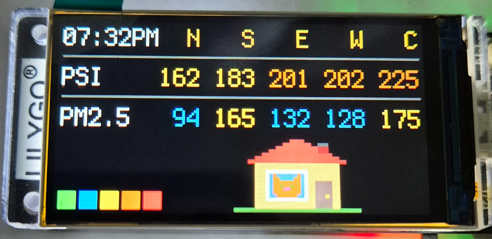
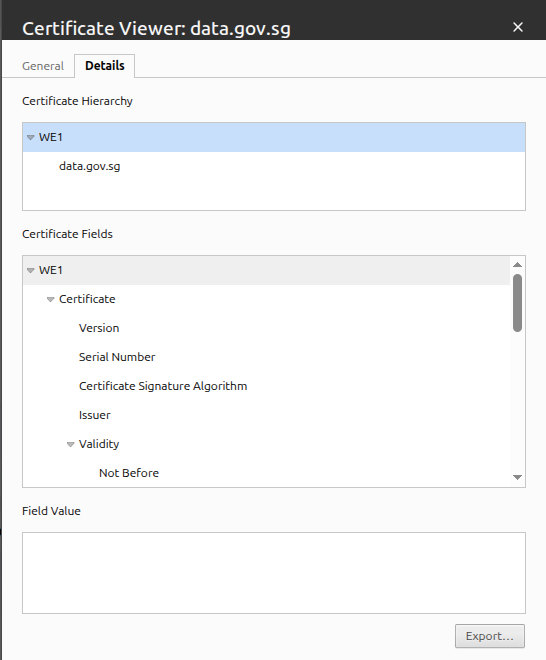
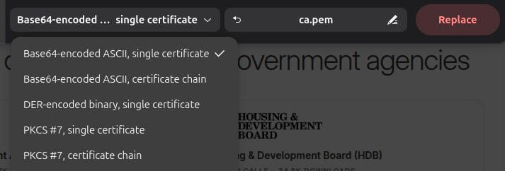

# LilyGo T-Display S3 Screens

One or more ad-hoc screens created on a microcontroller call LilyGo T-Display S3. Code written using Adafruit CircuitPython.

- Product Page - [Link](https://lilygo.cc/products/t-display-s3)
- Sample Code - [GitHub](https://github.com/Xinyuan-LilyGO/T-Display-S3)
- Adafruit CircuitPython - [Link](https://circuitpython.org/board/lilygo_tdisplay_s3/)


## 1. Setup

I flashed the LilyGo T-Display S3 with firmware board specific firmware by CircuitPython found [here](https://circuitpython.org/board/lilygo_tdisplay_s3/). The prepared board will show a `CIRCUITPY` USB drive when it is plugged into your computer.

### 1.1. Step 1
Create a `settings.toml` file in the `CIRCUITPY` folder if it does not exist. Fill in the values requried to connect to your WIFI hotspot.

```toml
CIRCUITPY_WIFI_SSID = "YOUR AP NAME"
CIRCUITPY_WIFI_PASSWORD = "YOUR AP PASSWORD"
CIRCUITPY_WEB_API_PASSWORD = "PASSWORD FOR WEB DEPLOYMENT"
```

### 1.2. Step 2
Copy the `code.py` file into the `CIRCUITPY` folder.


### 1.3. Additional CircuitPython Modules
None.


## 2. Screen A - Singapore NEA PSI & PM2.5 Display



The recent haze has got everyone very worried about the **PSI** (Pollutant Standards Index) and **PM2.5** (Particulate Matter of diameter 2.5 micrometer or smaller). This is a handy screen that I can summerize the latest readings from NEA's `data.gov.sg` APIs without having to go to the NEA Haze website via my phone or computer.

This screen makes use of these two free `data.gov.sg` APIs.
- PSI - [API Doc](https://data.gov.sg/datasets/d_fe37906a0182569d891506e815e819b7/view)
- PM2.5 - [API Doc](https://data.gov.sg/datasets/d_e1058d6974c877257e32048ab128ad83/view)

### 2.1. Features
This screen shows the following information.
- Auto-dimming of screen after 10 seconds. Press **Button 1** (Not the Boot or Reset buttons) to restore screen brightness for another 10 seconds.
- Show current time in GMT+8.
- Latest 24 hour PSI estimates and PM2.5 measurements grouped into Singapore's North (**N**), South (**S**), East (**E**), West (**W**), and Central (**C**) regions.
- Each data point is color coded according to the severity level used by Singapore NEA.
- A special advisory icon suggested by my lovely daughter.
  - **GREEN** Severity (*Lowest*) - **A Running Cat** >> go out and play.
  - **BLUE** Severity (*Moderate Low*) - **Sit Down Cat** >> avoid strenuous activities.
  - **YELLOW** Severity (*Medium*) - **Masked Cat** >> wear a mask if you must go out.
  - **ORANGE** Severity (*High*) - **Stay Home Cat** >> avoid going out.
  - **RED** Severity (*Critical*) - **Masked Home Cat** >> protect yourself even when at home.

These are the icons from **GREEN** to **RED** (left to right).


### 2.2. Debugging

There is a `OSError -12288` or `MBEDTLS_ERR_X509_FATAL_ERROR (-0x3000): the board could not verify the server's certificate chain against its built-in root CA bundle.` that happens from time to time between resets. This is due to the board not recognizing `data.gov.sg` certificate issuer as a valid root certificate authority.

The fix is as follows.
1. Open `data.gov.sg` in a web browser.
2. **View the Certificate** of the `data.gov.sg` website.
3. Make sure **WE1** is selected. Then click on the **Export** button.

4. Save the certificate in Base64 PEM ASCII format and name the file as `ca.pem`.

5. Copy ca.pem file into `CIRCUITPY` folder.

